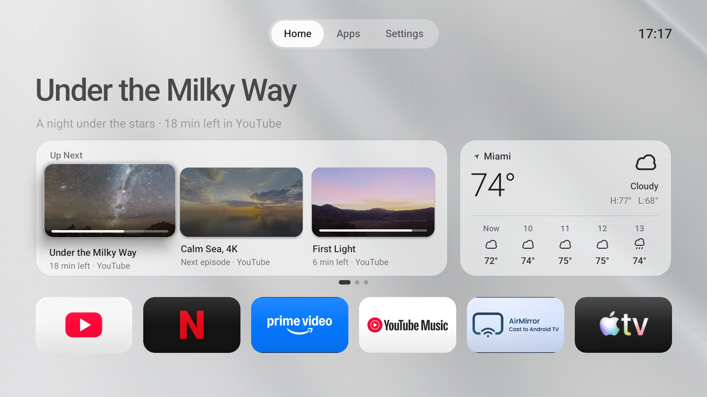

# Luma TV — edición TCL

> 🇬🇧 **In English:** An ad-free, Spanish-language home screen for Android TV and Google TV, based on Luma, with local smart-light control, TCL remote shortcuts and now-playing info.

Una pantalla de inicio tranquila y sin anuncios para Android TV y Google TV, en español, basada en
[Luma](https://github.com/0xProbabillity/luma-tv). Controla los focos de tu casa, abre apps con los botones del control
TCL y muestra lo que estabas viendo y escuchando, sin filas patrocinadas ni rastreo.

> 💡 Probada en una TCL Google TV con Android 12. Debería funcionar en cualquier Android TV con Android 8.0 o
> superior; lo específico de TCL está señalado.

<p align="center">
  
  <br><sub>Captura de Luma original (en inglés). Esta edición se ve igual, en español.</sub>
</p>

## Contenido

- [¿Qué es?](#-qué-es)
- [Qué puedes hacer](#-qué-puedes-hacer)
- [Instalación](#-instalación)
- [Uso con el control](#-uso-con-el-control)
- [Adáptala a tu casa](#-adáptala-a-tu-casa)
- [Privacidad y permisos](#-privacidad-y-permisos)
- [Volver al launcher original](#-volver-al-launcher-original)
- [Problemas comunes](#-problemas-comunes)
- [Desarrollo](#-desarrollo)
- [Estructura](#-estructura)
- [Créditos y licencia](#-créditos-y-licencia)

## 🎯 ¿Qué es?

Un **launcher** es la pantalla que aparece al apretar *Home* en la tele. El de Google TV ocupa mucha memoria y llena
el inicio de anuncios y recomendaciones. Esta app lo reemplaza por una pantalla simple: tus apps favoritas y unos
cuantos widgets útiles sobre un fondo animado.

Es para quien tiene una Android TV o Google TV (en especial TCL), habla español y quiere un inicio limpio, sin
depender de cuentas ni de la nube.

## ✨ Qué puedes hacer

El inicio tiene tres páginas de widgets sobre tu fila de apps:

| Página | Widgets |
|---|---|
| 1 | **A continuación**: lo que estabas viendo en Netflix, Prime Video y otras apps (una tarjeta por serie, máximo dos por app). **+** abre hasta 12. · **Clima**: OK cambia de ciudad, mantener OK cambia entre horas y días. |
| 2 | **Luces**: tus focos por cuarto, todos a la vez y un panel de colores. · **Reproduciendo**: la música que suena en la tele, con un reproductor a pantalla completa. |
| 3 | **Entradas**: HDMI y TV en vivo; **Más** abre todas. · **Control**: red, imagen y sonido, accesorios y configuración. |

- **Todo en español:** interfaz, fechas, ciudades y mensajes del instalador.
- **Luces sin app ni nube:** focos **WiZ** y **CozyLife** por tu red local. Prender y apagar, brillo, blancos
  de 2700 a 6500 K, ocho colores y perfiles (Película, Lectura, Cena, Relajado, Fiesta, Apagar).
- **Reproductor grande:** la canción con su carátula sobre un fondo difuminado, barra de progreso y controles grandes.
- **Botones del control TCL:** YouTube, Prime Video, Netflix, ViX y Apple TV abren la app que elijas, desde
  cualquier pantalla.
- **Silenciosa:** sin sonidos al moverte; solo uno suave al abrir una app (se apaga en Ajustes).

De Luma original se conservan los fondos animados, el modo claro de día y oscuro de noche, mantener OK sobre una app
para moverla u ocultarla, y la pestaña Apps con todo lo instalado.

## 📦 Instalación

Se instala desde una computadora conectada a la misma red que la tele.

**Necesitas:**

| Dónde | Qué |
|---|---|
| Tele | Depuración por red activada: Configuración → Preferencias del dispositivo → Información, presiona *Compilación* 7 veces y activa la depuración en Opciones para desarrolladores |
| Computadora | macOS o Linux con [ADB](https://developer.android.com/tools/releases/platform-tools) |
| Para compilar | JDK 17 o superior, Android SDK build-tools `36.0.0` y plataforma `android-34`, Python 3. No usa Gradle |

**Pasos:**

```bash
adb connect <IP-de-tu-tele>:5555        # la IP está en Configuración → Red
cd luma
ANDROID_SDK_ROOT=<ruta-sdk> LUMA_JDK=<ruta-jdk> bash build.sh   # crea dist/luma-tv.apk
./luma.sh -s <IP-de-tu-tele>:5555 install
./luma.sh -s <IP-de-tu-tele>:5555 home      # Luma como pantalla de inicio
./luma.sh -s <IP-de-tu-tele>:5555 keys      # botones de apps del control
./luma.sh -s <IP-de-tu-tele>:5555 widgets   # permisos de A continuación y Reproduciendo
```

`./luma.sh status` muestra la tele, la versión instalada y qué app abre *Home*.

> ⚠️ La primera compilación crea una llave de firma en `luma/.signing/`. Guárdala: Android no deja actualizar la app
> con otra llave.

**Teles TCL:**

- Los botones del control necesitan el permiso `APP_AUTO_START` de TCL; `./luma.sh keys` lo concede. Sin él, el
  sistema de TCL bloquea el servicio de botones.
- El botón TCL Channel abre `com.tcl.waterfall.overseas`; si lo desactivaste, actívalo con
  `adb shell pm enable com.tcl.waterfall.overseas`.

## 🕹 Uso con el control

| Dónde | OK | Mantener OK |
|---|---|---|
| Una app | La abre | Mostrar en inicio, mover u ocultar |
| Clima | Cambia de ciudad | Horas ↔ días |
| Un cuarto en Luces | Prende o apaga | Cambia el brillo (100 → 50 → 20 %) |
| Colores | Abre el panel de colores | — |
| Reproduciendo ⤢ | Reproductor a pantalla completa | — |
| **+** / **Más** | Muestra todo | — |

*Atrás* cierra cualquier panel. Izquierda y derecha cambian de página.

## 🏠 Adáptala a tu casa

Algunas opciones son constantes en el código, configuradas para la tele donde se hizo esta edición. Cámbialas antes
de compilar; todas están en `luma/src/dev/luma/tv/`:

| Qué | Dónde |
|---|---|
| Tus focos (WiZ o CozyLife, por MAC) y los nombres de cuartos | `LightsWidget.BULBS`, `LightsWidget.ROOMS` |
| Ciudades del clima y sus coordenadas | `WeatherWidget.CITIES`, `WeatherWidget.PLACES` |
| Qué app abre cada botón del control (por código de tecla) | `KeyService.SCANS`, `KeyService.APPS` |
| Apps que no aparecen en A continuación | `UpNextWidget.HIDDEN` |

**Cómo encontrar los datos:**
- **Focos:** un WiZ responde a un broadcast UDP en el puerto 38899 y un CozyLife en el 6095; la respuesta trae su MAC.
- **Botones:** corre `adb shell getevent -lt` y presiona el botón; anota el código que aparece.
- **Saludo:** `LUMA_GREETING=Hola bash build.sh`, o tu nombre en Ajustes → *Tu nombre*.

## 🔒 Privacidad y permisos

La app no tiene cuentas ni analítica. Lo que sale de la tele:

- **Clima:** una petición a [Open-Meteo](https://open-meteo.com) (gratis, sin cuenta) con las coordenadas redondeadas de la ciudad.
- **Carátulas y pósters:** se descargan desde los enlaces que publican las propias apps.
- **Focos:** se controlan solo dentro de tu red local, sin internet.

Los ajustes se guardan en la tele, dentro de la app. Los permisos especiales se dan con `luma.sh` y se pueden quitar
en Configuración → Apps → Acceso especial:

| Permiso | Para qué |
|---|---|
| Lectura de listas de TV | A continuación (la lista *Seguir viendo* de Android TV) |
| Acceso a notificaciones | Reproduciendo; Luma no lee notificaciones, solo la sesión de música |
| Acceso a uso de apps | Apps usadas recientemente |
| Servicio de accesibilidad | Solo filtra los botones de apps del control; no lee la pantalla |

## ↩️ Volver al launcher original

```bash
./luma.sh -s <IP-de-tu-tele>:5555 restore
```

Reactiva el launcher que `home` apagó, regresa *Home* a él y quita el servicio de botones. Luma queda instalada
(`adb uninstall dev.luma.tv` la borra). `restore` recuerda qué cambió en cada tele, en `luma/.local/`.

## 🧰 Problemas comunes

| Problema | Qué hacer |
|---|---|
| *Home* abre otro launcher después de actualizar Luma | Desactiva ese launcher: `adb shell pm disable-user --user 0 <paquete>` |
| Un cuarto dice "Sin respuesta" | El foco está apagado desde el apagador o cambió de red; OK lo vuelve a buscar |
| Los botones del control no hacen nada | Corre `./luma.sh keys` otra vez (TCL puede quitar el permiso) |
| A continuación no muestra una app | Esa app no publica su *Seguir viendo* en Android TV (YouTube suele no hacerlo) |
| `adb` no encuentra la tele | La IP cambió: revisa Configuración → Red y vuelve a `adb connect` |

## 👨‍💻 Desarrollo

Java simple, sin AndroidX ni dependencias: un launcher vive en memoria todo el tiempo y cada dependencia cuesta RAM.
`build.sh` compila con `aapt2`, `javac` y `d8` directamente.

Las partes sin Android tienen pruebas que corren en la computadora, desde `luma/`:

```bash
javac -d build/test src/dev/luma/tv/Devices.java tools/DevicesTest.java && java -cp build/test dev.luma.tv.DevicesTest
javac -cp json.jar -d build/test src/dev/luma/tv/Wiz.java tools/WizTest.java && java -cp build/test:json.jar dev.luma.tv.WizTest
javac -cp json.jar -d build/test src/dev/luma/tv/Wiz.java src/dev/luma/tv/Cozy.java tools/CozyTest.java && java -cp build/test:json.jar dev.luma.tv.CozyTest
javac -d build/test src/dev/luma/tv/WatchNext.java tools/WatchNextTest.java && java -cp build/test dev.luma.tv.WatchNextTest
```

`json.jar` es la librería `org.json` (la copia de Android no funciona fuera de Android).

## 🗺 Estructura

| Ruta | Qué hay |
|---|---|
| `luma/src/dev/luma/tv/` | El código: `MainActivity` (inicio), un archivo por widget, `Wiz` y `Cozy` (protocolos de focos), `KeyService` (botones) |
| `luma/res/` | Recursos: textos, sonidos, fondos |
| `luma/tools/` | Pruebas y generadores (sonidos, zonas horarias) |
| `luma/build.sh` | Compilación sin Gradle |
| `luma/luma.sh` | Instalar, poner como inicio, permisos y restaurar |

## 🙏 Créditos y licencia

Basada en [Luma](https://github.com/0xProbabillity/luma-tv) de [@0xProbabillity](https://x.com/0xProbabillity),
con licencia MIT ([`luma/LICENSE`](luma/LICENSE)). `luma/` es un *git subtree* de ese repositorio; para traer sus
mejoras:

```bash
git subtree pull --prefix=luma https://github.com/0xProbabillity/luma-tv.git main
```

Haz merge de los pull requests con *merge commit*, no con *squash*, para no romper el historial del subtree.
